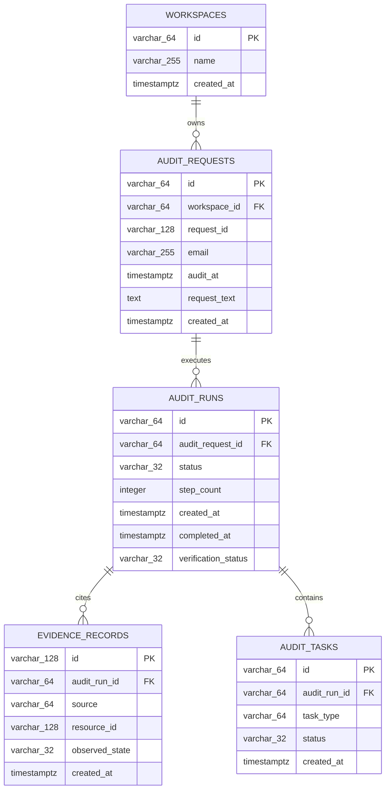

# تقرير Sprint 4C.1: تكامل منصة PrivacyGuard AI مع PostgreSQL

## 1. ملخص التنفيذ وفحص خط الأساس

كان مسار المنصة يتكون من FastAPI وSQLAlchemy ومستودعات ORM وخدمة
`AuditExecutionService`، لكن التشغيل الفعلي كان يعتمد على SQLite. أظهر الفحص
الأولي ما يلي:

- كانت `create_app()` تستخدم `sqlite:///privacyguard_platform.db` كقيمة
  افتراضية.
- كان التطبيق ينفذ `Base.metadata.create_all()` عند بدء التشغيل.
- كان ملف Alembic يشير إلى SQLite بصورة مستقلة عن إعداد التطبيق.
- كانت مراجعة Alembic الأولى فارغة؛ أي أنها تسجل رقم المراجعة فقط ولا تنشئ
  جداول المنصة.
- كانت المستودعات تنفذ `commit()` داخلياً، مما وزع حدود المعاملة بين عدة
  طبقات.
- كان اختبار API يحقن `sqlite:///:memory:` مباشرة، وهي آلية مناسبة للاختبارات
  المعزولة.
- المشغل الافتراضي كان ينتج نتيجة `NOT_RUN` اصطناعية؛ أزيل هذا السلوك حتى لا
  تُختلق نتيجة تحقق خصوصية.

قاعدة SQLite الأصلية ما زالت موجودة من دون تعديل. آخر فحص قراءة وجد مساحتي
عمل، وطلب تدقيق واحداً، وتشغيلاً واحداً، ولم يجر أي نسخ تاريخي إلى PostgreSQL.

## 2. السبب الجذري لاستخدام SQLite وقت التشغيل

السبب لم يكن عجز SQLAlchemy عن الاتصال بـPostgreSQL، بل ثلاث قرارات إعداد:

1. قيمة SQLite افتراضية داخل `create_app()`.
2. عدم قراءة متغير بيئة خاص بقاعدة المنصة.
3. قيام التطبيق بإنشاء الجداول ذاتياً، بينما لم تكن مراجعة Alembic تنشئها.

نتيجة ذلك أن أمر Uvicorn الموثق كان يشغل SQLite دائماً، حتى مع وجود PostgreSQL
محلياً. عولج السبب بإلزام `PRIVACYGUARD_DATABASE_URL` للتشغيل العادي، وإلزام
`PRIVACYGUARD_MIGRATION_DATABASE_URL` لـAlembic، ومنع أي رجوع صامت إلى SQLite.

## 3. قاعدة البيانات ونظام إدارة قواعد البيانات

**قاعدة البيانات** هي البيانات المنظمة نفسها: الجداول والسجلات والقيود.
أما **نظام إدارة قواعد البيانات DBMS** فهو البرنامج الذي يدير التخزين
والمعاملات والتزامن والصلاحيات. ملف SQLite قاعدة بيانات ومحرك SQLite مكتبة داخل
عملية Python. أما PostgreSQL فهو DBMS مستقل يعمل كخادم ويستقبل اتصالات العملاء.

### SQLite مقابل PostgreSQL

| الجانب | SQLite | PostgreSQL |
|---|---|---|
| البنية | ملف ومكتبة داخل العملية | خادم وعميل عبر اتصال |
| التزامن | مناسب للاختبارات والأحمال الصغيرة | مناسب لتعدد المستخدمين والكتابة المتزامنة |
| الصلاحيات | صلاحيات ملف النظام | أدوار وامتيازات دقيقة |
| الأنواع الزمنية | تمثيل محدود للمنطقة الزمنية | `TIMESTAMP WITH TIME ZONE` |
| الاستخدام هنا | اختبارات معزولة فقط | قاعدة التشغيل المحلية الأساسية |

في البنية client-server يكون FastAPI/SQLAlchemy عميلاً، وPostgreSQL خادماً.
ينشئ `Engine` مجمع اتصالات، وتستعير كل `Session` اتصالاً عند الحاجة ثم تعيده.

## 4. تصميم الإعداد

يوجد الإعداد في `src/privacyguard/platform/database.py`:

- `resolve_database_url()` يقرأ المتغير الصريح المناسب.
- `validate_database_url()` يرفض أي PostgreSQL لا يستهدف الاسم الحرفي
  `privacyguard_platform`.
- SQLite مقبول عند حقنه صراحة في الاختبار، مثل
  `create_app("sqlite:///:memory:")`.
- `sanitized_database_identity()` يعرض السائق والمستخدم والمضيف والمنفذ واسم
  القاعدة من دون كلمة مرور.
- لا توجد بيانات اعتماد حقيقية في الشيفرة أو الأمثلة.

أمثلة مكانية فقط:

```text
PRIVACYGUARD_DATABASE_URL=postgresql+psycopg://privacyguard_platform_runtime:<RUNTIME_PASSWORD>@localhost:5432/privacyguard_platform
PRIVACYGUARD_MIGRATION_DATABASE_URL=postgresql+psycopg://privacyguard_platform_migrator:<MIGRATION_PASSWORD>@localhost:5432/privacyguard_platform
```

إذا كانت كلمة المرور تحتوي رموز URL محجوزة فيجب ترميزها. لا ينبغي وضع الرابط
الحقيقي في سطر أوامر أو سجل أو مستند خاضع للتحكم بالإصدارات.

## 5. SQLAlchemy ORM والمفاهيم الكائنية

### Class وObject

الصنف `Workspace` هو وصف لبنية مساحة العمل وسلوك ربطها. أما
`Workspace(id="w1", name="...")` فهو كائن فعلي في الذاكرة يمثل صفاً قبل أو
بعد حفظه.

### Encapsulation وAbstraction

المستودع مثل `WorkspaceRepository` يغلف تفاصيل `add()` و`flush()` والاستعلام.
الـRouter لا يحتاج معرفة SQL. هذه **Encapsulation** لأنها تجمع الوصول للبيانات
في طبقة، و**Abstraction** لأنها تقدم عملية مفهومة مثل `create()` بدلاً من تفاصيل
الاتصال والاستعلام.

### Composition وDependency Injection

`create_app()` يركب `PlatformDatabase` و`AuditExecutionService` والمشغل الحقيقي
بدلاً من توريثها. وحقن `database_url` و`audit_runner` يسمح للاختبار باستخدام
SQLite ومشغل اصطناعي معلن، بينما يحتاج التشغيل الحقيقي إلى مشغل تدقيق مهيأ.
لا ينتج المشغل غير المهيأ أي نتيجة؛ بل يفشل التنفيذ تقنياً.

### Engine وSession

`Engine` كائن طويل العمر يدير Dialect ومجمع الاتصالات. أما `Session` فهي وحدة
عمل قصيرة العمر:

1. تنشأ لكل طلب HTTP.
2. تنفذ المستودعات `flush()` لإرسال SQL من دون امتلاك قرار الحفظ.
3. تنفذ dependency `commit()` بعد نجاح endpoint.
4. تنفذ `rollback()` عند الخطأ.
5. تغلق الجلسة دائماً.
6. يغلق lifespan الخاص بالتطبيق مجمع الاتصالات عبر `engine.dispose()`.

## 6. المعاملات وACID

تعني ACID:

- **Atomicity**: تنجح المعاملة كلها أو تتراجع كلها.
- **Consistency**: تبقى القيود صحيحة.
- **Isolation**: لا ترى المعاملات حالة وسيطة غير مسموحة.
- **Durability**: يبقى `commit` بعد نجاحه.

في طلبات CRUD، يمتلك request dependency قرار `commit/rollback`. في
`AuditExecutionService` توجد حدود مقصودة:

1. يحفظ التشغيل والمهمة بحالة تقنية `PENDING` في معاملة مستقلة قبل استدعاء
   محرك التدقيق الحقيقي؛ وبذلك تبقى محاولة التنفيذ قابلة للتتبع.
2. بعد عودة المحرك، تحفظ الأدلة وحالة المهمة والنتيجة في معاملة إكمال.
3. إذا فشل المحرك، تحفظ الحالة التقنية `FAILED`، وتظل
   `verification_status=NULL` لأن فشل التنفيذ ليس حكماً على اكتمال الخصوصية.

## 7. المخطط والعلاقات والقيود



### المفاتيح والقيود

- كل جدول له Primary Key نصي صريح.
- Foreign Keys تستخدم `ON DELETE CASCADE` من الأب إلى الأبناء.
- علاقات ORM واحد-إلى-متعدد تستخدم `delete-orphan` و`passive_deletes=True`،
  ليعمل حذف ORM المتعمد وحذف PostgreSQL المتسلسل بصورة متوافقة.
- القيد `uq_workspace_request` يمنع تكرار `request_id` داخل مساحة العمل.
- الأعمدة المطلوبة تحمل `NOT NULL`؛ `completed_at` و`verification_status`
  فقط قابلان لـNULL حسب دورة الحياة.
- `audit_at` أصبح `DateTime(timezone=True)` بدلاً من نص، ويصبح في PostgreSQL
  `TIMESTAMP WITH TIME ZONE`.

### الفهارس

- `ix_audit_requests_workspace_created_at`
- `ix_audit_runs_request_created_at`
- `ix_evidence_records_audit_run_id`
- `ix_audit_tasks_audit_run_id`

اختيرت لتسريع مسارات القراءة الفعلية وعمليات الربط والحذف المتسلسل. القيد
الفريد ينشئ فهرسه الخاص؛ لم نكرر فهرساً مطابقاً له.

## 8. Alembic وإدارة المخطط

المراجعة `2091eaa64392` تنشئ الجداول الخمسة والقيود والفهارس، و`downgrade`
يعكسها بترتيب آمن. لا ينشئ FastAPI مخطط PostgreSQL وقت التشغيل.

قبل أي migration:

- يتحقق عنوان URL من اسم `privacyguard_platform`.
- يطبع Alembic هوية هدف منزوعة كلمة المرور.
- عند الاتصال الحي ينفذ `SELECT current_database()` ويرفض أي اسم مختلف.

تم التحقق من SQL الخاص بـPostgreSQL في وضع Alembic offline فقط. لم تطبق
migration حية لأن اكتشاف الخادم لم ينجح بالمصادقة ولم يصدر إذن صريح بالتغيير.

## 9. أدوار PostgreSQL والصلاحيات

التصميم المقترح، بعد الاكتشاف والموافقة فقط:

- `privacyguard_platform_owner`: مالك `NOLOGIN`.
- `privacyguard_platform_migrator`: دخول مخصص لـAlembic، بلا صلاحيات superuser
  أو إنشاء قواعد/أدوار.
- `privacyguard_platform_runtime`: `CONNECT` و`USAGE` وعمليات DML فقط.

الملف `scripts/discover_platform_postgres.sql` قراءة فقط. أما
`provision_platform_postgres.sql` فيرفض العمل إذا وجد قاعدة أو دوراً بالاسم
المستهدف، ويطلب كتابة عبارة موافقة صريحة. لا يجوز تشغيله قبل مراجعة نتيجة
الاكتشاف والحصول على موافقة المستخدم.

حالة الإعداد الحالية: خدمة PostgreSQL 18.4 تستجيب محلياً، لكن محاولة القراءة
بحساب `postgres` رفضت لعدم توفر كلمة مرور. لذلك لا نعرف هل القاعدة أو الأدوار
موجودة، ولم يجر أي إنشاء أو تعديل أو migration على PostgreSQL.

## 10. الحفاظ على SQLite

لم يحذف أو يعدل أو يعاد ضبط `privacyguard_platform.db`. البيانات التاريخية
تبقى متاحة. يقبل هذا السبرنت PostgreSQL جديداً بسجلات اختبار اصطناعية، لذلك لا
يحدث نسخ تاريخي تلقائي.

يوجد `scripts/migrate_platform_sqlite.py` لاستخدام مستقبلي منفصل فقط. يفتح
المصدر بـ`mode=ro` و`PRAGMA query_only`، ويرفض هدفاً غير فارغ، وينفذ الإدراج
في معاملة واحدة. تشغيله يحتاج مراجعة مستقلة وموافقة صريحة ولا يدخل في خطوات
البدء المعتادة.

## 11. FastAPI وHTTP

لم تتغير عقود المسارات المطلوبة:

- `GET /health/live`: استجابة 200 إذا كانت العملية حية.
- `GET /health/ready`: ينفذ `SELECT 1`؛ يعيد 503 برسالة عامة عند تعذر القاعدة.
- إنشاء مساحة أو طلب يعيد 201.
- القراءة الناجحة تعيد 200.
- المورد غير الموجود يعيد 404.
- تعارض المفتاح أو المعرف يعيد 409 مع rollback.
- فشل محرك التدقيق يعيد 500 من دون تسريب تفاصيل الاتصال أو الاستثناء.

حالة `AuditRun.status` تقنية (`PENDING/COMPLETED/FAILED`). أما
`verification_status` فهي نتيجة الخصوصية الحقيقية من المشغل. لا يحول فشل تقني
إلى `COMPLETE` أو `INCOMPLETE` ولا يخترع أدلة.

عندما يعيد المشغل معرفات أدلة فقط، تحفظ المنصة المعرف نفسه كـ`resource_id`
والمصدر العام الصادق `audit_runner` والحالة `UNKNOWN`. لا تنسب الدليل إلى
SmartShop ولا تدعي حالة لم يقدمها بروتوكول المشغل.

وصول SmartShop يبقى عبر الموصل الحالي للقراءة فقط، ولا تستخدم منصة التخزين
عنوان SmartShop. حارس اسم القاعدة يمنع توجيه منصة الكتابة إلى `smartshop_test`
أو `gold_wallet_db` أو `construction_erp`.

## 12. الاختبارات والنتائج

الاختبارات العادية تستخدم SQLite معزولة، وتفعل Foreign Keys فيها حتى لا تخفي
اختلافاً مهماً عن PostgreSQL. تغطي الصحة وCRUD والتعارض والـrollback وفصل
الحالة التقنية عن نتيجة الخصوصية وفشل الاتصال.

الملف `tests/platform/test_postgresql_integration.py` اختياري صراحة، ولا يعمل
إلا عند `PRIVACYGUARD_RUN_POSTGRES_TESTS=1`. وهو مصمم للتحقق من:

1. اسم الاتصال والمراجعة الحالية.
2. إنشاء مساحة واستمرارها بعد إعادة إنشاء التطبيق.
3. إنشاء الطلب والتشغيل.
4. Foreign Keys.
5. علاقات الأدلة والمهام.
6. commit وrollback.
7. التكرار وHTTP 409.
8. بقاء الكتابة داخل `privacyguard_platform`.

هذه الاختبارات تكتب سجلات UUID اصطناعية وتحذف سجلاتها فقط. لم تشغل حياً في
هذا السبرنت لعدم توفر المصادقة والموافقة. لذلك لا ندعي تحقق PostgreSQL حي.

النتيجة النهائية للأمر الصارم مع تعطيل cache غير المتاح واستخدام مجلد مؤقت داخل
المشروع: **294 passed, 7 skipped, zero warnings** خلال 35.02 ثانية. من حالات
التخطي حالتان جديدتان لتكامل PostgreSQL الحي، وقد تخطتا لأن مفتاح الموافقة لم
يفعل. لا تعد هذه النتيجة تحققاً لاتصال PostgreSQL؛ إنها تثبت عدم حدوث regression
في الاختبارات العادية وصحة بوابة opt-in.

## 13. عرض الجداول والسجلات في pgAdmin

بعد الاكتشاف والموافقة وإنشاء القاعدة وتطبيق Alembic:

1. افتح pgAdmin وسجل الخادم المحلي من `Servers` من دون حفظ كلمة المرور إن لم
   تسمح سياسة الجهاز بذلك.
2. وسع `Servers > PostgreSQL 18 > Databases`.
3. تحقق بصرياً من اختيار `privacyguard_platform`، لا SmartShop ولا أي قاعدة
   أخرى.
4. وسع `Schemas > public > Tables` لرؤية الجداول الخمسة.
5. افتح جدولاً ثم `Columns` لمراجعة الأنواع و`Constraints` للمفاتيح.
6. افتح `Indexes` لرؤية الفهارس الأربعة والقيد الفريد.
7. لعرض سجلات اصطناعية: انقر بالزر الأيمن على الجدول ثم
   `View/Edit Data > All Rows`.
8. لا تعدل صفوفاً تاريخية يدوياً. استخدم Query Tool للقراءة:

   ```sql
   SELECT id, name, created_at FROM workspaces ORDER BY created_at;
   SELECT id, audit_request_id, status, verification_status FROM audit_runs;
   ```

9. للتحقق من الإصدار:

   ```sql
   SELECT version_num FROM alembic_version;
   ```

10. أغلق Query Tool من دون حفظ أي كلمة مرور أو تصدير بيانات حساسة.

## 14. أوامر التشغيل المحلية الآمنة

### أ. اكتشاف قراءة فقط

```powershell
& "C:\Program Files\PostgreSQL\18\bin\psql.exe" `
  --dbname postgres `
  --file scripts/discover_platform_postgres.sql
```

### ب. بعد المراجعة والموافقة فقط

للتثبيت الجديد المؤكد فقط، شغل ملف provisioning تفاعلياً. سيتوقف عند أي
تعارض اسم ويطلب عبارة الموافقة وكلمات المرور من دون إظهارها.

### ج. تطبيق Alembic بعد موافقة migration

```powershell
$env:PYTHONPATH = "src"
$env:PRIVACYGUARD_MIGRATION_DATABASE_URL = "postgresql+psycopg://privacyguard_platform_migrator:<MIGRATION_PASSWORD>@localhost:5432/privacyguard_platform"
& ".\.venv\Scripts\python.exe" -m alembic current
& ".\.venv\Scripts\python.exe" -m alembic upgrade head
```

### د. تشغيل API

```powershell
$env:PRIVACYGUARD_DATABASE_URL = "postgresql+psycopg://privacyguard_platform_runtime:<RUNTIME_PASSWORD>@localhost:5432/privacyguard_platform"
& ".\.venv\Scripts\uvicorn.exe" privacyguard.platform.app:create_app --factory
```

هذه قيم مكانية؛ لا تنسخ كلمة مرور حقيقية إلى سجل المحادثة.

## 15. الملفات المنشأة والمعدلة

- `src/privacyguard/platform/database.py`
- `src/privacyguard/platform/app.py`
- `src/privacyguard/platform/models.py`
- `src/privacyguard/platform/repository.py`
- `src/privacyguard/platform/service.py`
- `alembic/env.py`
- `alembic/versions/2091eaa64392_initial_platform_schema.py`
- `scripts/discover_platform_postgres.sql`
- `scripts/provision_platform_postgres.sql`
- `scripts/migrate_platform_sqlite.py`
- `tests/platform/test_platform_api.py`
- `tests/platform/test_platform_database.py`
- `tests/platform/test_postgresql_integration.py`
- `.env.example`, `.gitignore`, `pyproject.toml`, `README.md`
- هذا التقرير و`docs/postgresql_platform.md`

## 16. القرارات والبدائل

- **إعداد صريح بدلاً من SQLite افتراضي:** يمنع تشغيل الإنتاج على ملف محلي
  بالخطأ.
- **Alembic بدلاً من `create_all`:** يوفر تاريخ إصدار قابل للمراجعة والترقية.
- **دور مالك بلا login:** يقلل استخدام هوية امتلاك الكائنات مباشرة.
- **فصل migrator عن runtime:** يمنع التطبيق من تغيير المخطط.
- **`flush` في المستودع و`commit` في طبقة الوحدة:** يجعل حدود المعاملة واضحة.
- **`TIMESTAMPTZ` بدلاً من نص:** يتيح المقارنة والفهرسة الزمنية الصحيحة.
- **اختبارات PostgreSQL opt-in:** تمنع كتابة غير مقصودة، مع إبقاء تحقق حي حقيقي
  ممكناً بعد الموافقة.
- **عدم نسخ SQLite تلقائياً:** يحافظ على المصدر ويلائم قبول قاعدة جديدة في هذا
  السبرنت.

## 17. فحوص الأمن والقيود المتبقية

فحوص الأمن:

- لا كلمات مرور حقيقية في المستودع.
- رسائل الجاهزية والأخطاء لا تعرض تفاصيل السائق.
- حارس صارم لاسم قاعدة المنصة.
- اكتشاف منفصل للقراءة فقط.
- provisioning يتوقف عند التعارض ويتطلب موافقة مكتوبة.
- لا migration أو اختبار PostgreSQL يعمل تلقائياً.
- لم يجر أي تعديل على SmartShop أو قواعد المشاريع الأخرى أو بيانات التحدي.

القيود:

- لم نتمكن من قراءة catalogs بسبب غياب مصادقة محلية؛ حالة القاعدة والأدوار غير
  معروفة.
- لم تطبق migration حية ولم تعمل اختبارات PostgreSQL الحية، فلا توجد دعوى نجاح
  تكامل حي.
- يلزم تهيئة مشغل تدقيق حقيقي عند التشغيل؛ عدم التهيئة يسجل فشلاً تقنياً من دون
  نتيجة خصوصية مصطنعة.
- المصادقة والتفويض لمستخدمي HTTP ما زالا خارج نطاق هذا السبرنت.

## 18. تقييم الجاهزية لـSprint 4D

الشيفرة وبنية الإعداد وAlembic والاختبارات الاختيارية جاهزة لمرحلة تحقق 4D، لكن
الانتقال التشغيلي ليس مكتملاً. بوابة الجاهزية هي:

1. توفير وسيلة مصادقة محلية آمنة من المستخدم.
2. تشغيل discovery وقراءة النتائج.
3. اتخاذ قرار صريح بشأن الموجود بدلاً من افتراض الغياب.
4. موافقة صريحة على أي إنشاء/منح صلاحيات.
5. موافقة منفصلة على Alembic ثم تشغيله مع تحقق الهدف.
6. تشغيل اختبارات PostgreSQL الاختيارية وتسجيل نتائجها الحقيقية.
7. بعد نجاح ذلك فقط يمكن وصف تكامل PostgreSQL بأنه متحقق حياً والانتقال إلى
   تحسينات 4D مثل التزامن والمراقبة والمصادقة.
